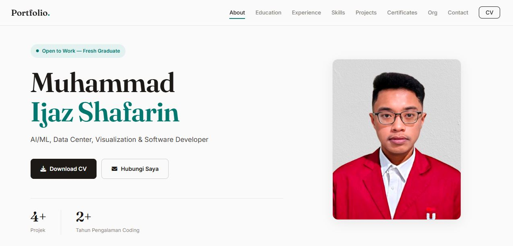

# Portofolio Profesional — Muhammad Ijaz Shafarin



Website portofolio pribadi yang dirancang bersih, ringan, dan mudah dijelajahi. Menyajikan latar belakang pendidikan, pengalaman kerja, kemampuan teknis, proyek, sertifikat, hingga kegiatan organisasi dalam satu halaman yang rapi dan responsif.

**Live Demo:** [https://ijazshafarin-porto.netlify.app]

---

## Tentang Portofolio

Lulusan S1 Informatika Telkom University Surabaya (Cumlaude) dengan minat di bidang AI/Machine Learning, data center, visualisasi data, dan pengembangan software. Portofolio ini dibuat sebagai etalase karya dan pengalaman nyata, sekaligus bukti kemampuan merancang antarmuka web yang profesional dari nol tanpa framework.

## Fitur Unggulan

- **Desain minimalis dan profesional.** Palet warna netral dengan satu aksen teal, tipografi Inter dan Fraunces, serta animasi halus yang tidak mengganggu.
- **Satu halaman, navigasi jelas.** Menu otomatis menandai bagian yang sedang dilihat sehingga pengunjung selalu tahu posisinya.
- **Filter proyek berdasarkan bidang.** Pengunjung dapat langsung menyaring proyek Machine Learning, Web Development, atau IoT & Infrastruktur.
- **Galeri detail proyek.** Setiap proyek memiliki galeri gambar dengan navigasi panah, penghitung halaman, dan dukungan tombol keyboard.
- **Zoom sertifikat.** Sertifikat dapat diperbesar dalam tampilan penuh untuk dilihat dengan jelas.
- **Visualisasi kemampuan.** Bar skill terisi saat di-scroll, dilengkapi kelompok hardware dan tools.
- **Formulir kontak yang terhubung langsung ke email.** Pesan dikirim melalui Netlify Forms, lengkap dengan validasi isian dan notifikasi berhasil atau gagal.
- **Kontak instan.** Tautan LinkedIn, Gmail, Outlook, dan Instagram langsung membuka halaman tulis pesan.
- **Unduh CV dengan satu klik** dari bagian atas halaman maupun navbar.
- **Responsif penuh.** Tampilan menyesuaikan desktop, tablet, dan ponsel.
- **Ringan dan siap dibagikan.** Gambar dimuat bertahap (lazy loading), serta dilengkapi meta tag SEO dan Open Graph agar tautan tampil rapi saat dibagikan.

## Struktur Bagian

| Bagian | Isi |
| --- | --- |
| About | Profil singkat dan kekuatan utama |
| Education | Riwayat pendidikan SMK hingga S1 |
| Experience | Pengalaman magang dan Maganghub |
| Skills | Programming, Data & ML, Web, Hardware, Tools |
| Projects | Proyek ML, AIoT, web, dashboard, dan infrastruktur data center |
| Certificates | Sertifikat dan pelatihan |
| Organization | Kegiatan dan organisasi |
| Contact | Tautan kontak dan formulir pesan |

## Teknologi

- HTML5, CSS3 (CSS Variables, Grid, Flexbox)
- JavaScript (Vanilla, tanpa framework)
- Font Awesome dan Google Fonts
- Netlify (hosting dan Netlify Forms)

## Struktur Folder

```
├── index.html
├── css/
│   ├── style.css
│   └── tambahan.css
├── js/
│   ├── script.js
│   └── tambahan.js
├── images/
└── files/
```

## Menjalankan Secara Lokal

```bash
git clone https://github.com/ijazshafarin99/New_Template_Portofolio_Professional.git
cd New_Template_Portofolio_Professional
```

Buka `index.html` di browser, atau gunakan ekstensi Live Server di VS Code. Catatan: formulir kontak hanya berfungsi setelah situs di-deploy ke Netlify.

## Deploy

1. Push repository ini ke GitHub.
2. Di Netlify pilih **Add new site → Import an existing project**, lalu hubungkan repository.
3. Atur notifikasi email pada menu **Forms** agar pesan masuk ke email Anda.

## Kontak

- LinkedIn: [linkedin.com/in/Muhammad-ijaz-shafarin](https://linkedin.com/in/Muhammad-ijaz-shafarin)
- Email: ijaz.shafarin03@gmail.com
- Instagram: [@ijazshafarin_](https://instagram.com/ijazshafarin_)

---

© 2026 Muhammad Ijaz Shafarin. Seluruh konten dan foto dalam portofolio ini adalah milik pribadi.

Note: Silahkan jika kalian ingin menggunakan template ini, harap diganti seluruh dokumen pribadi pembuat dengan dokumen pribadi kalian. Terima kasih dan selamat menikmati :).
